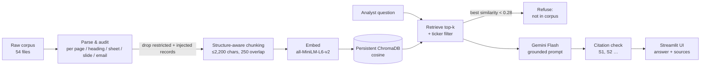

# Meridian Research Copilot — RAG POC

**From information backlog to grounded insights.**

DS602 RAG Mini-Project (SMU) — **Gou Hongyu, Deng Shenbojia**. Presented 16 September 2026.

> 中文简介：为虚构的投研团队 Meridian Capital Research 做的 RAG 问答机器人原型。它能跨 54 份杂乱文档回答问题，每个回答都标出来源，语料里没有的内容会直接拒答。语料是课程材料，不包含在本仓库中。

A Retrieval-Augmented Generation (RAG) chatbot that answers questions across a messy 54-document research corpus. Every answer cites its sources, and the bot refuses questions the corpus can't answer instead of guessing.

> ⚠️ The corpus is **fictitious teaching material**. Nothing here is real research or investment advice.

---

## What's in this repo

| Path | What it is |
|---|---|
| `notebooks/Meridian_Research_Copilot.ipynb` | Full pipeline in Google Colab: parse → audit → chunk → embed → index → retrieve → generate, plus tests |
| `app/app.py` | Streamlit chat UI with a **Research Chat** page and a **Corpus Health** audit page (the notebook writes the same file) |
| `slides/presentation.pdf` | Presentation deck (6 slides) |
| `slides/speaker_script_and_QA.md` | Speaker script and prepared Q&A answers |
| `requirements.txt` | Python packages |

## The data (not included)

The corpus is provided by the course and **is not committed here**: it is course material and not ours to redistribute. Its shape:

- **54 files**: 30 PDF, 10 Markdown, 4 DOCX, 4 XLSX, 3 PPTX, 3 EML
- Single-stock analyst notes, sector reviews, macro/rates research, three sets of dated central-bank (FMA) minutes, earnings call summaries, morning digests, financial models, internal decks, desk memos and forwarded emails (some with attachments)
- Ten fictional companies (e.g. VLTA, KRNX, CIRQ), one fictional central bank, and a ten-month macro storyline in which the policy stance changes twice
- Deliberately messy: scanned PDFs, hidden spreadsheet tabs, charts stored as images, a prompt injection, and near-duplicate versions

## Architecture



1. **Parse.** One parser per file type. Each page, heading section, sheet block, slide or email body becomes a "record" with source, location, ticker and date. Email attachments are pulled out and parsed too.
2. **Audit.** Files are hashed to catch exact duplicates. Each record is checked for prompt-injection phrases and hidden or restricted sheets, and empty pages are flagged as likely scans. Results go to `outputs/file_audit.csv` and `outputs/record_audit.csv`.
3. **Chunk.** Restricted and injected records are left out. Long records are split at about 2,200 characters with a 250-character overlap, preferring line or sentence breaks. Each chunk starts with a small metadata header.
4. **Embed and index.** Chunks are embedded locally with MiniLM and stored in a persistent ChromaDB, so the live demo never re-embeds.
5. **Retrieve.** Cosine search returns the top 8 distinct locations. If the question names a company or ticker, results are filtered to it.
6. **Generate.** Gemini answers only from the retrieved evidence, cites `[S1]`, `[S2]` and so on, and treats the documents as untrusted data rather than instructions.
7. **Validate.** Citation IDs are checked against the evidence. Weak retrieval (best similarity < 0.28) means the bot refuses instead of answering.

## Decisions log

| Decision | Why | Alternative we weighed | Trade-off |
|---|---|---|---|
| Structure-aware chunking (page / heading / sheet / slide first, then size split) | Keeps tables and section headers together in financial documents | Fixed-size chunks | Uneven chunk sizes and more parsing code, in return for chunks that make sense on their own |
| RAG, no fine-tuning | We need citations and up-to-date facts, not a writing style | Fine-tuning a model | Answers depend on retrieval quality, but cost nothing to update and can always be traced to a source |
| Local `all-MiniLM-L6-v2` embeddings | Free, no API rate limits, and the index persists, which keeps the live demo stable | Paid API embeddings (OpenAI / Gemini) | Some loss in semantic depth |
| ChromaDB with cosine distance, persisted to Drive | Simplest vector DB to start with; it survives Colab restarts | FAISS | Slightly heavier, but metadata filtering comes built in |
| Ticker-based metadata filter | Company questions should only retrieve that company's documents | Pure vector search | A question naming two companies only gets the first one |
| Strict refusal (similarity floor + prompt rule) | In finance, a confident wrong answer is a compliance risk | Letting the model guess | Some answerable questions get refused |
| Drop restricted and injected records before indexing | The model can't leak or obey text it never sees | Rely on the prompt alone | Legitimate text in a flagged record is also lost |
| Gemini Flash-class model | Free tier, fast enough for a live demo | Larger or paid models | Weaker multi-step reasoning across documents |

## What broke, and how we handled it

- **Prompt injection.** The Data Quality memo has hidden instructions addressed to AI assistants, trying to skew KRNX dividend answers. Pattern detection flags these records and keeps them out of the index. The prompt also tells the model to ignore instructions found in documents, and a notebook test checks that the injected text never shows up in an answer.
- **Hidden spreadsheet tab.** The rates model has a hidden `Internal_Overlay` sheet. The XLSX parser checks `sheet_state` and sheet names and excludes restricted sheets.
- **Scanned PDFs.** Two scanned memos give no text. Those pages are flagged with a warning; OCR is a production upgrade.
- **Charts as images.** Some forecasts only exist as pictures in the PPTX decks, so the bot refuses rather than guessing the numbers.
- **Cross-document questions.** These hit only about 50% in our tests, because the right chunks don't all land in the top-k.

## Setup (Google Colab)

1. Open `notebooks/Meridian_Research_Copilot.ipynb` in Google Colab. The free tier is fine and no GPU is needed.
2. In Colab's **Secrets** panel, add:
   - `GEMINI_API_KEY`: a Gemini API key (free tier)
   - `NGROK_AUTHTOKEN`: an ngrok token, used to open the Streamlit app from Colab
3. Run the cells in order. The notebook:
   - installs the packages and mounts Google Drive (the project folder is `MyDrive/meridian_rag/`)
   - asks you to upload `corpus.zip` (from the course)
   - parses and audits the corpus, then builds the Chroma index
   - runs test questions, including an injection test and an out-of-corpus question
   - writes `app.py` and starts Streamlit behind an ngrok link
4. Open the printed ngrok URL to use the chat UI.

### Running the app outside Colab

After the notebook has built `chroma_db/` and `outputs/`, you can run the app anywhere:

```bash
pip install -r requirements.txt
export GEMINI_API_KEY=your-key
export MERIDIAN_PROJECT_DIR=/path/to/meridian_rag   # folder containing chroma_db/ and outputs/
streamlit run app/app.py
```

## Path to production

- **Better retrieval:** hybrid search (BM25 + vectors) with a cross-encoder reranker for multi-document questions
- **More formats:** OCR / multimodal extraction for scanned PDFs and chart images
- **Access control:** document-level permissions (RBAC) tied to company login
- **Evaluation:** automated RAGAS metrics (faithfulness, answer relevance) on a fixed question set
